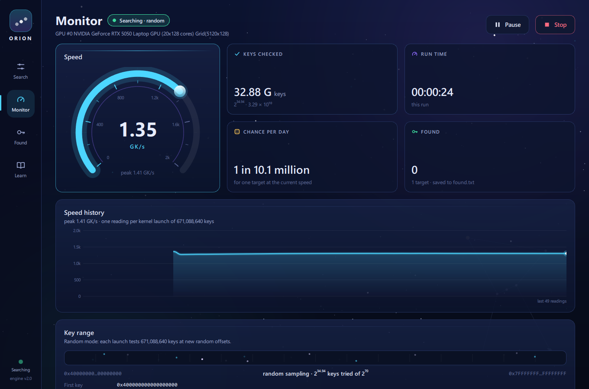

# Orion

High-throughput CUDA Bitcoin key-range scanner engineered for NVIDIA Blackwell (`sm_120`) GPUs.

Orion searches a contiguous private-key range for compressed P2PKH (`1...`) or P2WPKH (`bc1q...`)
addresses or prefixes. Its Blackwell GPU kernel achieves **22.9% fewer SM cycles per key**
and **+23.7% higher wall-clock throughput** over the unoptimised 64-bit baseline, with every change
A/B measured and independently verified in pure Python.

| Metric / GPU | Baseline (64-bit) | v1.2 | **Orion v2.0** |
|---|---|---|---|
| SM cycles per key (`sm_120`, locked clocks) | 1.000 | 0.893 (−10.7%) | **0.771 (−22.9%)** |
| RTX 5050 Laptop (80 W power cap, CUDA 13.4) | 989.2 MK/s | 1077.0 MK/s (+8.9%) | **1223.8 MK/s (+23.7%)** |
| RTX PRO 6000 Blackwell (Google Colab) | 8625 MK/s | 9479 MK/s (+9.9%) | *(not yet measured; −22.9% cycles)* |

Full profiling methodology, microbenchmarks, and rejected experiments are documented in
**[OPTIMIZATION.md](OPTIMIZATION.md)**.

## Architecture & Highlights

* **Native 32-bit `Wide32` secp256k1 arithmetic:** Comba `IMAD.WIDE.U32` field multiplication and
  squaring (−40% cycles in isolation), parallel `mul.wide` 512→256 reduction (zero `IADD.64` in the
  hot loop), and branchless `ModSub256_32`/`ModAdd256_32`.
* **Specialised kernels & RIPEMD-160 early-exit:** Compile-time `comp_keys<MODE>` specialisation
  skips the last 7 RIPEMD-160 half-rounds on `h[2]` mismatch for single and multi full-address
  searches (3 half-rounds for prefix searches).
* **Blackwell pipe balancing:** SHA-256 and RIPEMD-160 compile-time constants, folded rounds and
  padding, critical-path reordering, and `IMAD x·1 + y` additions (`ORION_FADD=7`) offloading work
  from the ALU-heavy pipe to the FMA pipe.
* **Barrier-free hot loop:** `ORION_NOBARRIER=1`, 128 threads/block (`ORION_TPB=128`,
  `ORION_BPSM=256`), 122 registers, 0 register spills, 0% barrier stalls.
* **Fast host & safe resume:** Multi-threaded CPU starting-key generation, by-value `JumpPoint`
  kernel arguments (zero blocking `cudaMemcpyToSymbol` in `-random` mode), atomic
  `orion_backup_gpu<N>.dat` checkpoints with range/layout validation, and strict CLI/address
  validation.
* **Tooling & verification:** Windows build script, 5-mode pure-Python planted-key self-test
  (`single`, `multi`, `bech32`, `prefix`, `--random`), wall-clock A/B and Nsight Compute cycle
  benchmarks, and `sm_120` microbenchmarks (`bench/`).

## Comparison with Other Bitcoin Puzzle Tools

Bitcoin puzzle solvers fall into two distinct categories depending on whether the target address's
**public key** is exposed on-chain:

* **Exposed public key (e.g. puzzles #135, #140, …):** Use an $O(\sqrt{N})$ ECDLP solver such as
  **Pollard's Kangaroo** (`JeanLucPons/Kangaroo`, `RCKangaroo`) or **BSGS** (`KeyHunt`). Brute-force
  scanners like Orion cannot compete with $O(\sqrt{N})$ methods when a public key is known.
* **Unspent address — only `hash160` is known (e.g. puzzles #71, #72, …):** No $O(\sqrt{N})$
  shortcut applies, so every candidate key must run the full `secp256k1 → SHA-256 → RIPEMD-160`
  pipeline. This is the workload Orion is built for.

### How Orion compares to other brute-force & puzzle tools

| Feature / Aspect | **Orion v2.0** | VanitySearch / BitCrack-style forks | BitCrack (`cuBitCrack` / `clBitCrack`) | KeyHunt-Cuda / Rotor-Cuda | KeyHunt (`albertobsd`) | Kangaroo / RCKangaroo |
|---|---|---|---|---|---|---|
| **Algorithm** | Brute-force range scan ($O(N)$) | Brute-force (vanity / range) | Brute-force range scan | Brute-force / xpoint / multi-mode | CPU BSGS, RMD160, xpoint, address | Pollard's Kangaroo ($O(\sqrt{N})$) |
| **Target hardware** | NVIDIA CUDA (tuned for **Blackwell `sm_120`**) | NVIDIA CUDA + CPU | NVIDIA CUDA & AMD OpenCL | NVIDIA CUDA | CPU (multi-threaded) | NVIDIA CUDA (+ CPU) |
| **EC field arithmetic on GPU** | Native 32-bit Comba `Wide32` (`IMAD.WIDE.U32`), parallel `mul.wide` reduction, branchless `ModAdd`/`ModSub` | 64-bit limbs (`_ModMult`/`_ModSqr`), branch-divergent `ModSub` | Legacy 32-bit/64-bit CUDA/OpenCL kernels | Mostly 64-bit VanitySearch-derived kernels | CPU GMP / secp256k1 | Specialized Kangaroo EC stepping |
| **Hash & check pipeline** | Compile-time `comp_keys<MODE>`, **RIPEMD-160 7-half-round early-exit** (`h[2]`), `IMAD` ALU→FMA pipe offload, barrier-free hot loop | Full RIPEMD-160, runtime branches, `__syncthreads()` in loop | Full SHA-256 + RIPEMD-160 | Bloom filter / sorted lookup, full RIPEMD-160 | CPU SSE/AVX + Bloom filter | No hashing (public-key x-coord only) |
| **Address types** | Compressed **P2PKH (`1…`)** & **P2WPKH (`bc1q…`)** | P2PKH, P2SH, Bech32 (comp + uncomp) | P2PKH (comp + uncomp) | P2PKH, P2SH, Bech32 (comp + uncomp), XPoint | P2PKH, P2SH, Bech32, XPoint | Public key only |
| **Search modes** | Sequential (`-start`/`-range`/`-end`), `-random` (by-value `JumpPoint`), prefix, multi-address | Vanity random, range in forks | Sequential / stride / random | Sequential, random, large target lists | BSGS, sequential, random | Public-key range ECDLP |
| **Resume / checkpoint** | Atomic `orion_backup_gpu<N>.dat` validated against range, thread count & `ORION_GRP` | Basic or legacy 12-byte offset file (or none) | Text checkpoint file | Varies by fork | Varies by mode | Distinguished-points workfiles |
| **Multi-GPU** | One process per GPU (`-gpuId N`) | Multi-GPU in one process | Multi-GPU (one device per instance / flag) | Multi-GPU in one process | N/A (CPU) | Multi-GPU |
| **Verification & profiling** | Built-in **pure-Python planted-key self-test** (5 modes), interleaved A/B bench, Nsight Compute cycle scripts | Basic CPU self-check | Basic check | Basic check | Built-in tests | Built-in tests |

### Key differences & trade-offs

* **Blackwell (`sm_120`) microarchitectural focus:** Most existing CUDA scanners still rely on
  64-bit VanitySearch/BitCrack arithmetic and full RIPEMD-160 pipelines designed for Pascal/Turing/Ampere.
  Orion was profiled directly on `sm_120` with Nsight Compute to eliminate `IADD.64` bottlenecks,
  offload additions from the saturated ALU-heavy pipe to the FMA pipe, cut 7 RIPEMD-160 half-rounds
  on the hot path, and remove block barriers — yielding **−22.9% SM cycles/key** and **+23.7%
  wall-clock speed** over the 64-bit baseline while keeping 122 registers and 0 spills.
* **Lean kernel vs. Swiss-army features:** Tools like **KeyHunt-Cuda**, **Rotor-Cuda**, and
  **BitCrack** support uncompressed keys, P2SH (`3…`), OpenCL/AMD GPUs, multi-million-address Bloom
  filters, or built-in multi-GPU/pool orchestration. Orion intentionally drops unused key modes so
  the hot loop stays narrow, branchless, and register-clean for compressed `1…` and `bc1q…` targets.
* **Independent correctness verification:** Rather than trusting the C++ binary to verify itself,
  `bench/bench.py selftest` hides a random key in a range and re-derives the reported key's address
  in pure Python, covering single-target, multi-target (`lookup32`), Bech32, prefix, and `-random`
  paths.
* **When to choose another tool:**
  * Target has a **known public key** → use **Kangaroo / RCKangaroo** or **KeyHunt (BSGS)**.
  * You need **AMD/OpenCL**, **CPU-only**, **uncompressed keys**, **P2SH (`3…`)**, **Taproot (`bc1p…`)**,
    or **millions of targets via Bloom filter** → use **BitCrack**, **KeyHunt**, or **KeyHunt-Cuda**.
  * You want **maximum single-GPU NVIDIA Blackwell throughput** on compressed `1…` or `bc1q…` puzzle
    ranges with atomic checkpoints and reproducible benchmarks → use **Orion**.

## Usage

```
orion [-gpuId N] [-start HEX] [-range BITS | -end HEX] [-stop] [-random] [-backup]
      [-i file] [-o file] [-m N] address...
```

| Option | |
|---|---|
| `-start HEX` | First private key, default 1. A `0x` prefix is accepted. |
| `-range BITS` | Scan `start` … `start + 2^BITS − 1` (default 30). |
| `-end HEX` | Last key (inclusive), for ranges that are not a power of two. |
| `-stop` | Stop once every address has been found. |
| `-random` | At every step all GPU threads jump to the same random offset within their own slice of the range. |
| `-backup` | Resume from `orion_backup_gpu<N>.dat`. Written every 60 launches, on pause, on Ctrl+C and at the end. A new run without `-backup` keeps the previous file as `.prev`. |
| `-i file` / `-o file` | Addresses to search (one per line, `#` comments) / file the found keys are appended to (with public key and time). |
| `-m N` | Maximum hits stored per kernel launch, default 262144. Raise it only after an "items lost" warning. |
| `-gpuId N` | GPU to use. One GPU per process: run one instance per GPU. |
| `-l` | List the CUDA devices. |
| `-json` | For front ends: JSON event lines on stdout, `pause`/`resume`/`stop` commands on stdin (see [docs/usage.md](docs/usage.md#front-ends--json)). |
| `-h`, `-v` | Help, version. |

While running, `p` pauses and releases the GPU, and `p` again resumes. **Ctrl+C** saves the progress
and exits (a second Ctrl+C exits at once). The exit code is 1 on errors and 0 otherwise.

## Build

**Linux**, CUDA ≥ 12.8 for `sm_120`:

```bash
make                 # -> ./orion for sm_120 (Blackwell)
make CCAP=89         # other GPUs: 89 = Ada, 86 = Ampere, ...
```

**Windows** (Visual Studio 2022 with "Desktop development with C++", CUDA ≥ 12.8, Python 3):

```bash
python bench/build.py opt            # -> build/opt/orion.exe, sm_120 (--arch 89 for Ada, ...)
```

`Orion.sln` also builds in Visual Studio for `sm_75 … sm_120` using the CUDA toolkit pointed to by
`CUDA_PATH` (`msbuild /p:CudaVersion=12.8` selects another installed version).

## Desktop app

`orion-gui` is a native Qt 6 Quick front end for Windows and Linux: it sets up a search (targets, puzzle
range presets, sequential or random mode, GPU), shows the speed, progress, odds and log live, resumes saved
progress, and lists the found keys. It runs the `orion` engine above, so build that first.

```bash
python gui/build.py                                          # Windows -> build/gui/orion-gui.exe
cmake -S gui -B build/gui && cmake --build build/gui         # Linux   -> build/gui/orion-gui
```



See [docs/gui.md](docs/gui.md) for requirements and details.

## Verify before you trust it

```bash
python bench/bench.py selftest build/opt/orion.exe --bits 36 --n 3            # sequential
python bench/bench.py selftest build/opt/orion.exe --bits 34 --n 3 --random   # -random mode
```

The self-test hides a random key in a small range, runs `orion`, and independently re-derives the
reported key's address in pure Python. `--target` selects the GPU path: `single` (default, one `1...`
address), `multi` (several full addresses via `lookup32`), `bech32` (one `bc1q...` address) and
`prefix` (leading characters of the address).

## Documentation

Full guides are in [`docs/`](docs/):

* [Getting started](docs/getting-started.md) — build, self-test, and a first search that finishes in a second.
* [Usage](docs/usage.md) — every option, address formats, the progress line, pause, random mode, backup/resume.
* [Searching a puzzle](docs/puzzle-search.md) — puzzle ranges, realistic odds, and handling a found key safely.
* [Troubleshooting](docs/troubleshooting.md) — build and runtime errors and their fixes.
* [How it works](docs/how-it-works.md) — what the GPU and CPU do for every key.
* [Desktop app](docs/gui.md) — building and using the Qt front end on Windows and Linux.

## License

Licensed under the GNU Affero General Public License v3; see [LICENSE.txt](LICENSE.txt).
Inherited source files retain their original copyright and GPLv3 notices in accordance with
GPLv3 section 13 / AGPLv3.
