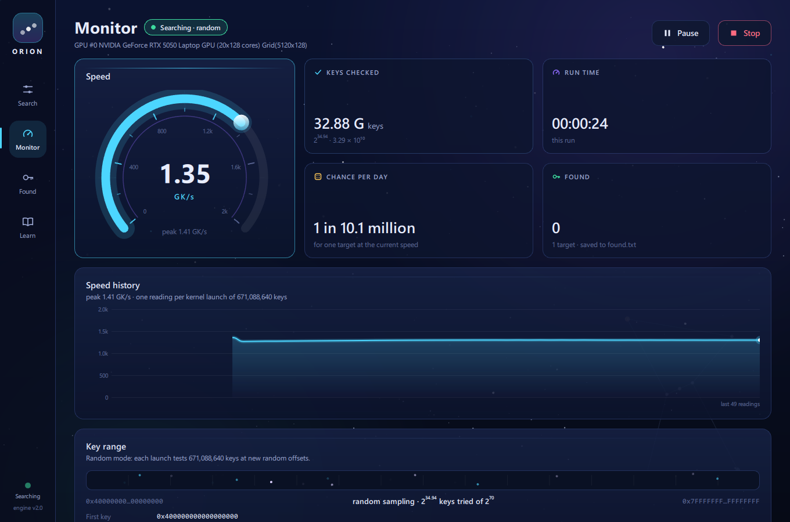

# Desktop app

`orion-gui` is a native desktop front end for Windows and Linux, written with Qt 6 Quick. It does no
cryptography itself: it runs the `orion` engine with [`-json`](usage.md#front-ends--json), shows what the
engine reports and sends it `pause`, `resume` and `stop`. Everything the command line can do with one GPU,
the app can do.



## Pages

* **Search** — targets (typed or loaded from a file, checked as you type: Base58Check and bech32
  checksums, P2SH and mixed types are flagged), the key range as a Bitcoin puzzle number, a start plus
  bits, or a start and an end, with its size and the time a full scan would take at this machine's speed.
  In puzzle mode the puzzle's address is filled in as the target (unless you typed your own targets:
  then **Use this address** does it), with its prize and whether its public key is on the chain;
  **All 160 puzzles…** lists every puzzle, open or solved, and picks one with a click. Then:
  random or sequential mode; the GPU; and **Saved progress**, which resumes a stopped sequential search.
  **Demo** fills in puzzle #30, solved long ago, which finds its key in about a second.
* **Monitor** — a speed gauge and history chart, keys checked, run time, time left (sequential) or the
  chance per day (random), the key range with the scanned share, the odds per hour, day, month and year,
  and the engine's log. **Pause** releases the GPU for other programs; **Stop** saves the progress.
* **Found** — every key in `found.txt`, newest first, with copy buttons (the private key and WIF stay
  hidden until you show them) and what to do before spending from a found address.
* **Learn** — the key-to-address pipeline, animated on the values of puzzle #30, the two search modes and
  what the odds really are.

Closing the window while a search runs stops it the way Ctrl+C does in a terminal: the progress is saved
first.

## The puzzle list

`gui/qml/Puzzles.js` holds the 160 puzzles. The addresses are the outputs of the puzzle transaction itself
(`08389f34…cd15`, January 2015), checked against the known keys of solved puzzles; the prize, whether a
puzzle is solved and whether its public key is on the chain come from the blockchain, on the date shown
in the list. Puzzles get solved over time: refresh the file with

```bash
python gui/puzzles.py      # about 160 requests to the Blockstream API, a minute or two
```

and rebuild the app. An open puzzle whose public key is on the chain is better attacked with Kangaroo or
BSGS than with a key scan; the app says so.

## Where things are kept

The app keeps its files in its data folder (the **Data folder** button opens it):

| Windows | Linux |
|---|---|
| `%LOCALAPPDATA%\Orion` | `~/.local/share/Orion` |

It holds `found.txt` (every found key, appended), `orion_backup_gpu<N>.dat` (saved progress, one per GPU),
`targets.txt` (the targets of the current search) and `settings.ini` (the last search set up, and the
engine path if you chose one). The engine runs in this folder, so a search started from the app and one
started from a terminal elsewhere do not share a backup file.

## Building

The app needs **Qt 6.5 or newer** (it is developed with 6.10.3) with Qt Quick, and CMake 3.21 or newer.
Build the engine as described in [getting-started.md](getting-started.md) as well.

### Windows

Visual Studio 2022 (the Build Tools are enough) provides the compiler, CMake and Ninja. Install Qt for
MSVC 2022 64-bit with the Qt online installer, or without an account with
[aqtinstall](https://github.com/miurahr/aqtinstall):

```bash
python -m pip install aqtinstall
python -m aqt install-qt windows desktop 6.10.3 win64_msvc2022_64 -O %USERPROFILE%\Qt
```

Then:

```bash
python bench/build.py opt      # the engine -> build/opt/orion.exe
python gui/build.py            # the app    -> build/gui/orion-gui.exe, with the Qt DLLs next to it
```

`gui/build.py` finds Qt in `%USERPROFILE%\Qt` or `C:\Qt`; pass `--qt <path>` or set `QT_DIR` otherwise.
`build/gui` can be copied to another machine as it is; put `orion.exe` in the same folder.

### Linux

Install Qt 6 from the distribution, for example:

```bash
# Debian 13, Ubuntu 24.10 or newer (Ubuntu 24.04 ships Qt 6.4, which is too old)
sudo apt install cmake g++ qt6-base-dev qt6-declarative-dev qml6-module-qtquick \
    qml6-module-qtquick-controls qml6-module-qtquick-layouts qml6-module-qtquick-shapes \
    qml6-module-qtquick-particles qml6-module-qtquick-dialogs qml6-module-qtquick-templates \
    qml6-module-qtquick-window qml6-module-qtqml-workerscript
# Fedora
sudo dnf install cmake gcc-c++ qt6-qtbase-devel qt6-qtdeclarative-devel
# Arch
sudo pacman -S cmake qt6-base qt6-declarative
```

Then, from the repository root:

```bash
make                                                         # the engine -> ./orion
cmake -S gui -B build/gui -DCMAKE_BUILD_TYPE=Release
cmake --build build/gui -j                                   # the app -> build/gui/orion-gui
./build/gui/orion-gui
```

## Finding the engine

The app looks for `orion` (`orion.exe` on Windows) in this order and uses the first one that answers to
`-json`:

1. the path chosen with **Engine → Change…** on the Search page,
2. the `ORION_EXE` environment variable,
3. the app's own folder,
4. `build/opt/` next to `build/gui/` (Windows build layout), and the repository root above `build/gui/`
   (Linux `make` layout),
5. the `PATH`.

An `orion` built from older sources has no `-json`; the app then says so and asks you to rebuild it.

## Command-line options

| Option | |
|---|---|
| `--page search\|monitor\|found\|learn\|puzzles` | Page to open first (`puzzles`: the puzzle list). |
| `--start` | Start the last search set up in the window right away. |
| `--grab file.png` | Save a screenshot of the window after `--grab-delay` ms (default 3000), then close it. |
